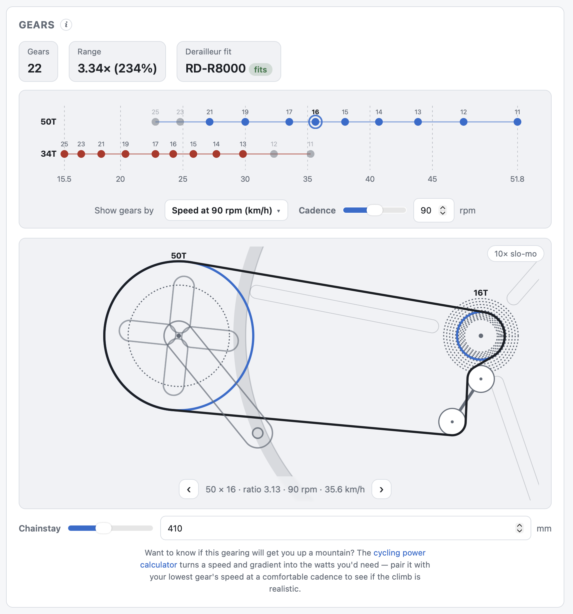
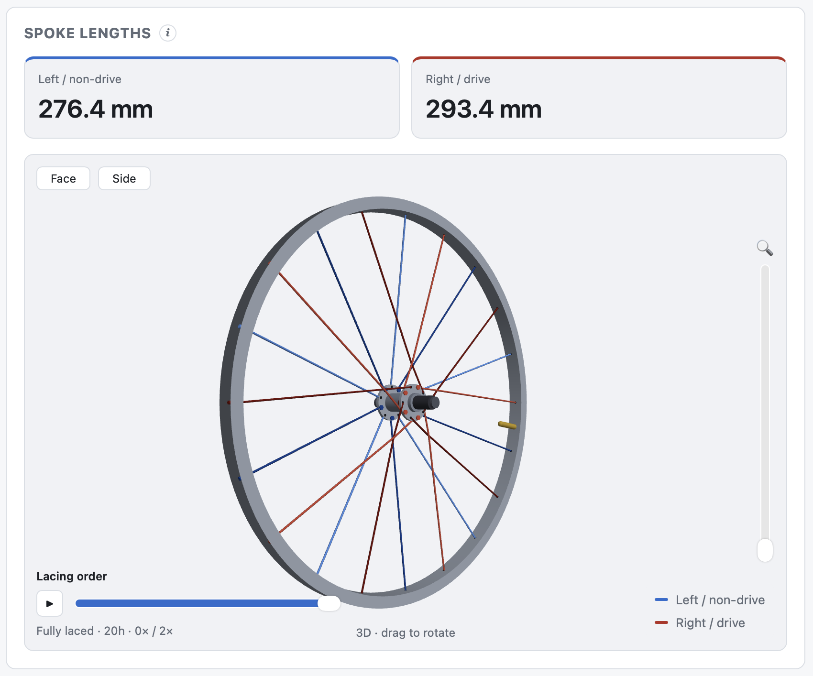

# Bike Workshop Calculator

I am volunteering in a community bike workshop. We repair donated bikes for refugees, and teach people how to fix bikes. Working on bikes often involves small calculations, for which there are many many great web calculators out there. So, why build another one?

- I never remember which one I liked best for which task, so I figured I would like to have a collection of different useful calculators all in one place.
- I wanted to build something which is very visual to let us use this as a tool to teach people how bike components work. So, the drivetrain calculator will actually show an animation of what the drivetrain would look like, and how shifting between the different gears works. The wheel building calculator can show a 3d visualization of the wheel with an animation of which order to put in the spokes when lacing the wheels.
- In our bike workshop, we often have old donated bikes with a very random mix of components - or you may try to find replacements from a box of used parts - and you don't know if components are actually compatible. So one goal of this calculator is to help you answer such questions. The drivetrain calculator lets you specify components (derailleurs, shifters and cassettes) and will validate them against known specs for the parts (gear counts, derailleur pull ratio, max cog size, capacity), to give you a judgement if they are expected to work together or not.

You can try the calculator live on the [Rückenwind web site](https://rueckenwind.berlin/bikeworkshopcalc/).




## Calculators

| # | Calculator | What it answers | Spec |
|---|-----------|-----------------|------|
| 1 | Drivetrain | Gear ratios, speed at cadence, gear inches/development (cassette, single speed, or geared hub), chain length, chain wear | [drivetrain.md](docs/calculators/drivetrain.md) |
| 2 | Wheel building | Spoke lengths for a given hub + rim + lacing, plus spoke tension converter | [wheel-building.md](docs/calculators/wheel-building.md) |
| 3 | Frame size | Frame size / saddle height / crank length from inseam or body height | [frame-size.md](docs/calculators/frame-size.md) |
| 4 | Tire | Convert tire size formats; recommend pressure | [tire.md](docs/calculators/tire.md) |
| 5 | Cycling power | Watts needed for a speed/gradient, speed from watts, and work / food energy over a ride | [power.md](docs/calculators/power.md) |
| 6 | Thread direction | Reference: which parts are left-hand threaded, and which way to turn to loosen/tighten | [thread-direction.md](docs/calculators/thread-direction.md) |

## Documentation

- [`docs/architecture.md`](docs/architecture.md) — page layout, navigation, and
  suggested tech approach.
- [`docs/calculators/`](docs/calculators/) — one spec per calculator with
  inputs, outputs, formulas, and reference data.

## Running locally

Requires Node 18+.

```bash
npm install
npm run dev      # start the dev server (http://localhost:5173)
npm run build    # type-check and build the static site into dist/
npm run preview  # preview the production build
npm test         # run the calculation unit tests (Vitest)
```

## Deployment

The project can be deployed from a local checkout with `scripts/deploy.sh`.
It pushes the current branch (best-effort), builds the site, uploads `dist/`
over SFTP, prunes obsolete hashed assets, and checks the live page. From this
workspace, install `expect` if needed, then provide the host settings only in
the current shell and run the script:

```bash
export DEPLOY_USER='your-sftp-user' DEPLOY_HOST='your-sftp-host'
export PASSWORD='your-sftp-password' REMOTE_DIR='/remote/path/to/site'
./scripts/deploy.sh
```

Do not commit credentials or put them in a tracked `.env` file. The script
also pushes `HEAD`, so make sure you intend to publish the current checkout
before running it. `dist/` is built locally; the site is static and can be
hosted from any subdirectory.

For a quick visual check of a page (headless Chrome via `puppeteer-core`; set
`CHROME_PATH` to override the browser):

```bash
npm run build && npm run preview -- --port 4320 &
npm run screenshot -- '#/drivetrain' out.png '.gc-dot'   # route, output, optional hover selector
```

The build is a static site (`dist/`) that can be served from any subdirectory;
`vite.config.ts` uses relative assets. Serve it over HTTP rather than opening
the files directly.

## Tech

- **Vite + React + TypeScript**, all math client-side (no backend).
- Pure calculation modules live in [`src/lib/`](src/lib/) and are unit-tested
  against the worked examples in the calculator specs (`npm test`).
- UI components (one per calculator) live in [`src/components/`](src/components/);
  the sidebar/routing shell is [`src/App.tsx`](src/App.tsx) with path-based navigation and real static HTML entry points for each calculator.

## Contributing

Feedback and suggestions are welcome. So are contributions/pull requests - in particular in the area of adding component data to the Cassette/Hub/Derailleur/Internal Gears [databases](src/data/README.md), but I will look at any submissions.

## License

Released under the [MIT License](LICENSE).

## Calculator URLs and SEO

Each calculator now has a directory URL under `/bikeworkshopcalc/`:

- `gear-ratio-chain-length-calculator/`
- `spoke-length-calculator/`
- `bike-frame-size-calculator/`
- `tire-pressure-calculator/`
- `bicycle-component-compatibility/`
- `cycling-power-calculator/`
- `bicycle-thread-direction/`

`src/routes.json` defines paths and metadata. `npm run build` generates an
`index.html` in each directory, containing a title, description, canonical URL,
short introduction and links usable before JavaScript loads. The interactive
calculators still run client-side; this is not full server-side rendering.
The root entry selects the drivetrain page. Legacy `#/drivetrain?...` links
migrate client-side using `replaceState`, retaining their configuration. Shared
settings now use ordinary query parameters; canonical URLs omit those settings.
The old iframe bridge retains hash navigation when explicitly embedded with
`?embed=fill` (or `?embed=auto` for auto-height). Ordinary preview iframes use
the new path URLs.

Upload **all of `dist/`**, including the seven page directories and `sitemap.xml`,
to the dedicated calculator directory alongside WordPress. No WordPress plugin
or SPA rewrite is needed: the server only needs to serve directory index files
and let existing files/directories bypass WordPress (the normal WordPress setup).
Do not overwrite WordPress's root files or `.htaccess`. The deployment script
uploads these entry points too; verify its host and remote directory before use.
`DEPLOY_URL` overrides the live verification URL if deploying elsewhere.

Production canonical URLs and the sitemap target
`https://rueckenwind.berlin/bikeworkshopcalc/` (configured in
`scripts/build-pages.mjs` and `src/useHashRoute.ts`). If moving domains, update
both. After deployment, submit
`https://rueckenwind.berlin/bikeworkshopcalc/sitemap.xml` in Google Search Console.
The sitemap intentionally excludes configurable query-string variants.
