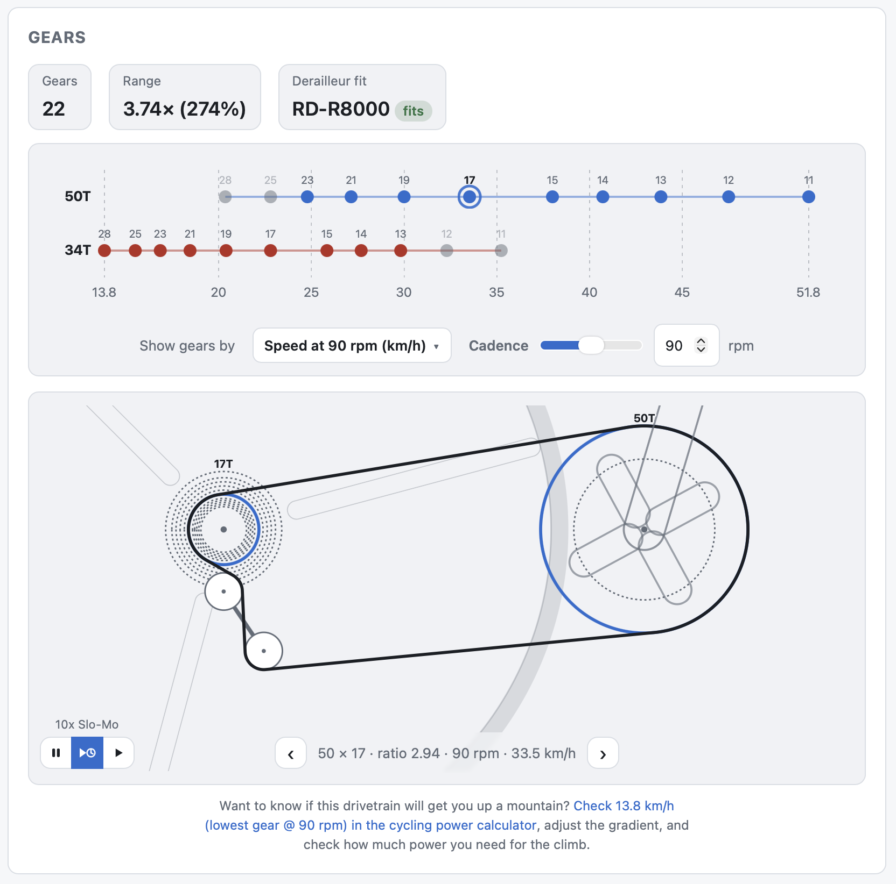
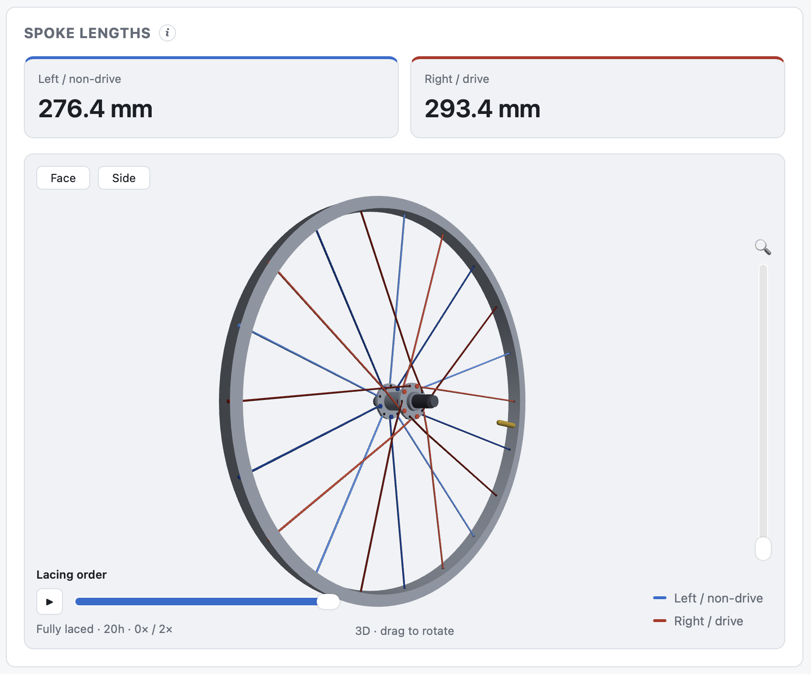
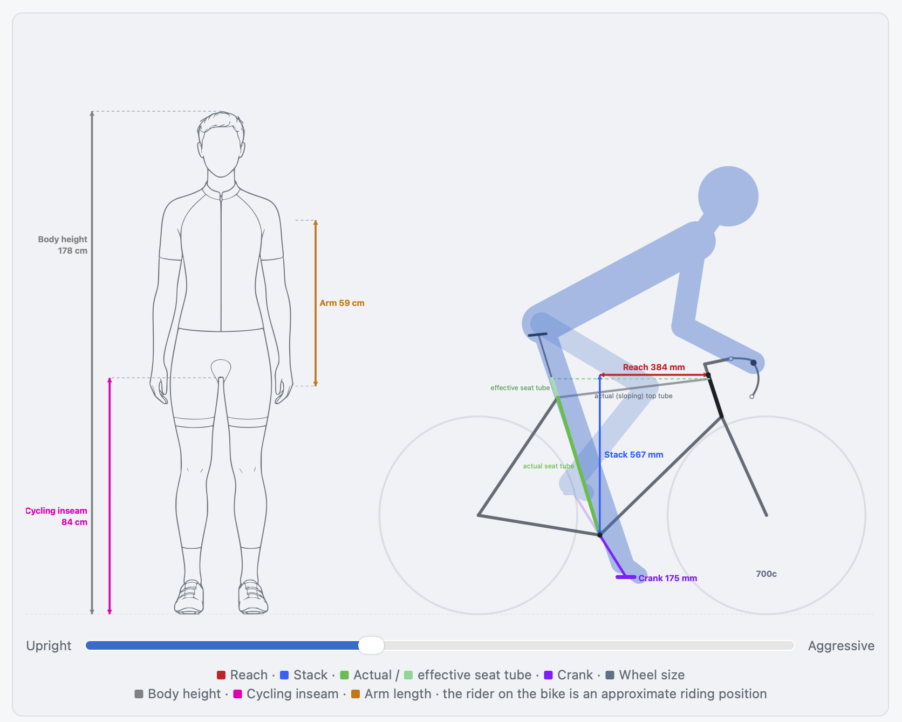

# Bike Workshop Calculator

I am volunteering in a community bike workshop. We repair donated bikes for refugees, and teach people how to fix bikes. Working on bikes often involves small calculations, for which there are many great web calculators out there. So, why build another one?

- I never remember which one I liked best for which task, so I figured I would like to have a collection of different useful calculators all in one place.
- I wanted to build something which is very visual to let us use this as a tool to teach people how bikes and bike components work. For instance:
  - The drivetrain calculator shows an animation of what the drivetrain would look like and how shifting between the different gears works.
  - The wheel building calculator shows a 3D visualization of the wheel with an animation of the order in which to insert the spokes when lacing the wheel.
  - The frame size calculator shows how a person with the specified body dimensions would sit on a frame with the specified dimensions.
- In our bike workshop, we often have old donated bikes with a very random mix of components - or you may try to find replacements from a box of used parts - and you don't know if components are actually compatible. So one goal of this calculator is to help you answer such questions. The drivetrain calculator lets you specify components (derailleurs, shifters and cassettes) and will validate them against known specs for the parts (gear counts, derailleur pull ratio, max cog size, capacity), to give you a judgement if they are expected to work together or not.

You can try the calculator live on the [Rückenwind web site](https://rueckenwind.berlin/bikeworkshopcalc/).





## Calculators

| # | Calculator | What it answers | Spec |
|---|-----------|-----------------|------|
| 1 | [Drivetrain](https://rueckenwind.berlin/bikeworkshopcalc/gear-ratio-chain-length-calculator/) | Gear ratios, speed at cadence, gear inches/development (cassette, single speed, or geared hub), chain length, chain wear | [drivetrain.md](docs/calculators/drivetrain.md) |
| 2 | [Wheel building](https://rueckenwind.berlin/bikeworkshopcalc/spoke-length-calculator/) | Spoke lengths for a given hub + rim + lacing, plus spoke tension converter | [wheel-building.md](docs/calculators/wheel-building.md) |
| 3 | [Frame size](https://rueckenwind.berlin/bikeworkshopcalc/bike-frame-size-calculator/) | Frame size / saddle height / crank length from inseam or body height | [frame-size.md](docs/calculators/frame-size.md) |
| 4 | [Tire](https://rueckenwind.berlin/bikeworkshopcalc/tire-pressure-calculator/) | Convert tire size formats; recommend pressure | [tire.md](docs/calculators/tire.md) |
| 5 | [Components](https://rueckenwind.berlin/bikeworkshopcalc/bicycle-component-database/) | Look up specifications for derailleurs, wheel hubs, internal gear hubs, gearboxes, and cassettes used by the other calculators | [components.md](docs/calculators/components.md) |
| 6 | [Cycling power](https://rueckenwind.berlin/bikeworkshopcalc/cycling-power-calculator/) | Watts needed for a speed/gradient, speed from watts, and work / food energy over a ride | [power.md](docs/calculators/power.md) |
| 7 | [Thread direction](https://rueckenwind.berlin/bikeworkshopcalc/bicycle-thread-direction/) | Reference: which parts are left-hand threaded, and which way to turn to loosen/tighten | [thread-direction.md](docs/calculators/thread-direction.md) |

## Maintenance log

The **Maintenance Log** supports manual bikes, mileage updates, and service
history without an Intervals.icu account. **Supabase Auth sign-in**
(email code or optional Intervals.icu login) is required; bikes and maintenance are stored in the cloud and available across
devices. Sign-in is tab-only by default; opting into “Remember me” keeps it for up
to 180 days, with automatic access-token refresh. Signed-out visitors see a muted, non-interactive sample log
with a sign-in banner. There is no editable demo, browser-only editing mode, or
independent browser-garage import option.

Intervals.icu is one optional connection for **sign-in and automatic bike/mileage
sync together**. Connect through More or sign in with Intervals.icu; both use
server-held S256 PKCE with public client 2006 and read-only settings access, not
personal API keys. OAuth tokens never enter the browser or garage backups. They
are encrypted in Supabase Vault, so mileage refreshes when you reopen the garage
and every five visible, idle minutes. Maintenance is never sent upstream.

Verified provider emails can match an existing confirmed email account, keeping
the same garage and email-code fallback. Stable athlete-ID mappings take priority
over later email changes. **More → Disconnect Intervals.icu** removes the login
link and encrypted mileage credential together, attempts provider revocation, and
keeps bikes, history, email access, and current Supabase sessions. Signing out
keeps the connection for next time. There are no separate login/sync toggles.

See [setup, security, and migration](docs/maintenance-accounts.md). Cloud setup
requires a database migration, public frontend configuration, and an email-code
template. Browser and legacy records are not erased or silently uploaded.
Export garage backups regularly; **More → Import garage backup** restores missing
bikes and entries from those files without overwriting existing cloud records. The old Intervals.icu and Strava server
scaffolds remain for operator reference, not current authentication or in-page recovery.

## Documentation

- [`docs/architecture.md`](docs/architecture.md) — page layout, navigation, and
  suggested tech approach.
- [`docs/calculators/`](docs/calculators/) — one spec per calculator with
  inputs, outputs, formulas, and reference data.

## Running locally

Requires Node 18+.

```bash
npm install
npm run dev      # start the dev server (http://localhost:5173)
npm run build    # type-check and build the static site into dist/
npm run preview  # preview the production build
npm test         # run the calculation unit tests (Vitest)
```

## iPhone home-screen app

Open a calculator in Safari and choose **Share → Add to Home Screen**. The web
manifest scopes the app to the whole calculator directory. Home-screen mode uses
same-document hash navigation so switching calculators also stays inside older
installs saved from an individual calculator page. Ordinary browser visits keep
the search-friendly page URLs; embedded views retain their existing behavior.
The iPhone touch icon (180×180) and manifest icons (192×192 and 512×512) in
`public/icons/` use `src/assets/rueckenwind-mark.png`, fitted within an opaque
white square with padding for home-screen corner rounding.
Settings and shared links continue to work in both modes. An internet connection
is still required; this does not add offline caching.

After an update, fully close and reopen the home-screen app. If iOS retains old
installation metadata or an old icon, remove its home-screen icon and add it
again from Safari.
To verify on an iPhone, install from a nested calculator URL, switch calculators,
change settings, and reopen a copied link. Switching should not open a Safari
view. Desktop tests emulate standalone detection but cannot validate iOS chrome.

## Deployment

The project can be deployed from a local checkout with `scripts/deploy.sh`.
It pushes the current branch (best-effort), builds the site, uploads `dist/`
over SFTP (including the manifest and icons), prunes obsolete hashed assets,
and checks the live page and exact web-app asset contents. From this workspace, install `expect` if needed, then provide the host settings only in
the current shell and run the script:

```bash
export DEPLOY_USER='your-sftp-user' DEPLOY_HOST='your-sftp-host'
export PASSWORD='your-sftp-password' REMOTE_DIR='/remote/path/to/site'
export DEPLOY_URL='https://rueckenwind.berlin/bikeworkshopcalc/'
./scripts/deploy.sh
```

Do not commit credentials or put them in a tracked `.env` file. The script
also pushes `HEAD`, so make sure you intend to publish the current checkout
before running it. `dist/` is built locally; the site is static and can be
hosted from any subdirectory.

For a quick visual check of a page (headless Chrome via `puppeteer-core`; set
`CHROME_PATH` to override the browser):

```bash
npm run build && npm run preview -- --port 4320 &
npm run screenshot -- '#/drivetrain' out.png '.gc-dot'   # route, output, optional hover selector
```

The build is a static site (`dist/`) that can be served from any subdirectory;
`vite.config.ts` uses relative assets. Serve it over HTTP rather than opening
the files directly.

## Tech

- **Vite + React + TypeScript**, all calculator math client-side. The maintenance
  page requires Supabase Auth/cloud storage, with read-only Intervals.icu sync.
  Cloud failures never silently fall back to local writes.
- Pure calculation modules live in [`src/lib/`](src/lib/) and are unit-tested
  against the worked examples in the calculator specs (`npm test`).
- UI components (one per calculator) live in [`src/components/`](src/components/);
  the sidebar/routing shell is [`src/App.tsx`](src/App.tsx) with path-based navigation and real static HTML entry points for each calculator.

## Contributing

Feedback and suggestions are welcome. So are contributions/pull requests - in particular in the area of adding component data to the Cassette/Hub/Derailleur/Internal Gears [databases](src/data/README.md), but I will look at any submissions.

## License

Released under the [MIT License](LICENSE).
